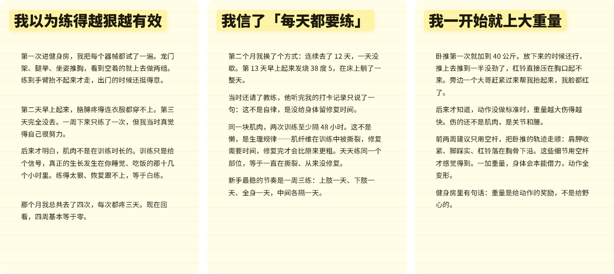

# 图文坊 WappKit

> 一段文案进，一套能直接发的竖版图文出。

面向抖音图文、小红书图文的**离线**排版工具。粘一份 Markdown，导出 1080×1440 的 PNG，直接发。

Windows 10 / 11 x64 · GPL-3.0 · 完全离线不联网 · 免费无水印



<sub>以上三页由本工具直接导出，未经二次修图。默认主题「苹果备忘录」、背景纯色 `#fff7e9`、四角无任何水印。</sub>

---

## 30 秒看懂

**它解决什么**：写图文最耗时间的环节不是写，是**排版和分页**——一段话写多长才刚好填满一页？标题会不会断在半截？页码、日期、落款该不该留？导出来的图能不能不修直接发？每次手排半小时。

这个工具只做一件事：**把「文案 → 成图」这段路上所有琐碎判断，变成一套调好的固定参数。**

**它是给谁用的**：已经在做（或准备做）抖音图文号、小红书图文笔记的人；手上有 Markdown 或愿意用 Markdown 写稿的人；不想把内容上传到在线工具的人。

**它不是给谁用的**：需要 AI 一键生成文案的人（本工具不接任何大模型，不联网）；需要自动发布到平台的人（只管出图）；需要视频剪辑的人。

---

## 安装

到 [Releases](https://github.com/wappkit/tuwen-fang/releases) 下载最新的 `tuwenfang_x.y.z_x64-setup.exe`，双击安装（安装后程序名为「图文坊」）。

- 系统要求：Windows 10 1809 及以上 / Windows 11，x64
- 安装包约 7 MB，装完约 19 MB，不需要 .NET、不需要联网、不需要 API Key
- 首次启动会显示一份 6 页的上手指南，看完就会用


---

## 为什么做这个

写图文最耗时间的环节不是写，是**排版和分页**。

这些事每次手排要半小时，而工具要么是在线的（要登录、要会员、要上传内容），要么只给模板不管分页。

---

## 三条调过的默认值，以及依据

这一版做的是**把默认值调对**，不是堆功能。下面每个数字都是同一段内容反复导出、逐张量出来的。

### 一页写多少字

| 每段字数 | 结果 |
|---|---|
| 250 | 被拆成 11 页，同一个小标题跨两页 |
| 155 | 正文止于页面 60%，下半屏空白 |
| **215–220** | 正文止于页面 73%–78%，**采用** |

结论：单页容量上限约 220–230 字（含标点）。低于 215 会空，高于 230 会被拆页。

这是判断「图能不能发」的第一道尺子，跟工具无关，写稿时就得按这个切。

### 背景色为什么从渐变改纯色

默认背景原是一道青绿→紫的对角渐变（预设名「薄荷星云」）。它在信息流里读起来像促销海报，与干货内容的气质不合。改成纯色 `#fff7e9` 后，配色收敛到与纸面同一色系，整张图从「海报」变成「笔记」。

### 四个标头为什么默认关

页眉 `@账号名`、页码 `01 / 07`、日期、落款「由 xxx 自动排版」四处，默认全部打开时，每发一套图就多四次替别人署名。默认关闭，要用再自己开——尤其页眉留着自己填账号名更合适。

---

## 相对上游改了什么

| 项 | 上游原样 | 现在 |
|---|---|---|
| 默认主题 | 瑞士网格 | **苹果备忘录**（衬线、纸面、长文友好） |
| 默认背景 | 青绿→紫渐变 | **纯色 `#fff7e9`** 暖阳底色 |
| 四个标头（页眉/页码/日期/落款） | 默认全开 | **默认全关**，要签名再自己开 |
| 关于页第三方推广位 | 有 | 已移除 |
| 设置页「支持我们」（赞赏码、公众号二维码） | 有 | **整页删除，不留入口** |
| 界面语言 | 中英混排的部分品牌名 | 全中文 |
| 更新签名密钥 | 上游公钥 | 自有密钥，不会自动更新成原版 |
| 自动检查更新 | 默认开启、启动即联网 | **默认关闭**，需手动打开 |

功能面沿用上游：Markdown 进、PNG 出，内置 16 套主题，支持 3:4（1080×1440）与 9:16（1080×1920），支持长图导出，无会员、无导出水印、无页数限制。

---

## 发帖前自查

不用相信预览缩略图，压到 120px 宽看不出排版。导出后逐张看四件事，全过才算可发：

1. 四角干净，没有任何小字
2. 正文落点在页面 70% 以上
3. 没有一句话被拆到两页
4. 标题没有单字挂行

---

## 隐私

**完全不联网。** 没有统计、没有埋点、没有检查更新、没有网络验证。

自动更新功能虽然保留（Tauri updater），但**默认关闭**，只有用户在设置里主动打开才会在启动时访问发布页；不开就是纯本地程序。

---

## 已知问题

诚实列出来，省得你踩：

- **标题按字宽断行**，可能把词切断，例如「5 个坑」被断成「5 /」和「个坑」。绕法：标题写短一点，或手动换行。
- **不支持批量文件队列**，一次只能处理一篇（批量是下个版本的事）。
- **首次启动稍慢**，Tauri 要初始化 WebView2，约 1–2 秒。
- **Windows 10 1809 以下未测试**，不保证能跑。
- 导出的 PNG 体积偏大（1080×1440 单页约 350–400 KB），7 页一套约 2.5 MB。

---

## 与上游的关系

本项目基于 [pangxiaobin/MarkCardStudio](https://github.com/pangxiaobin/MarkCardStudio) 二次开发，原项目以 GPL-3.0 发布。

**本仓库同样是 GPL-3.0，不含任何闭源组件。** 上游的版权声明、协议文本与项目结构一并保留。

我们的改动集中在：

- 排版默认参数（主题 / 背景 / 标头）
- 全量中文化与品牌替换（程序名、界面文案、欢迎文档）
- 移除上游的第三方推广位与外部链接
- 更换更新签名密钥，避免自动更新回上游原版

**排版引擎、分页算法、主题样式表均未改动**，这些是上游作者的工作，也是这个项目能存在的前提，在此致谢。

上游内置的 OpenMoji 素材以 CC BY-SA 4.0 授权，署名一并保留。

---

## 开发

技术栈沿上游：Vue 3 + Vite + Tauri 2（Rust）。

```bash
npm install
npm run tauri dev      # 开发
npm run tauri build    # 打包（Windows NSIS 安装包）
```

构建环境（Windows）：

- Node.js 18+
- Rust stable + MSVC 工具链（VS Build Tools 的 C++ 生成工具 + Windows SDK）
- 打包签名：设置 `TAURI_SIGNING_PRIVATE_KEY` 指向私钥文件

---

## 更新

版本更新只在 [Releases](https://github.com/wappkit/tuwen-fang/releases) 发布，不另开分支、不推送弹窗。

想收更新通知：右上角 **Watch → Custom → 只勾 Releases**，有新版本会收到一封邮件，不会打扰。

---

## 协议

GPL-3.0-only。见 [LICENSE](LICENSE)。

- 上游项目：https://github.com/pangxiaobin/MarkCardStudio
